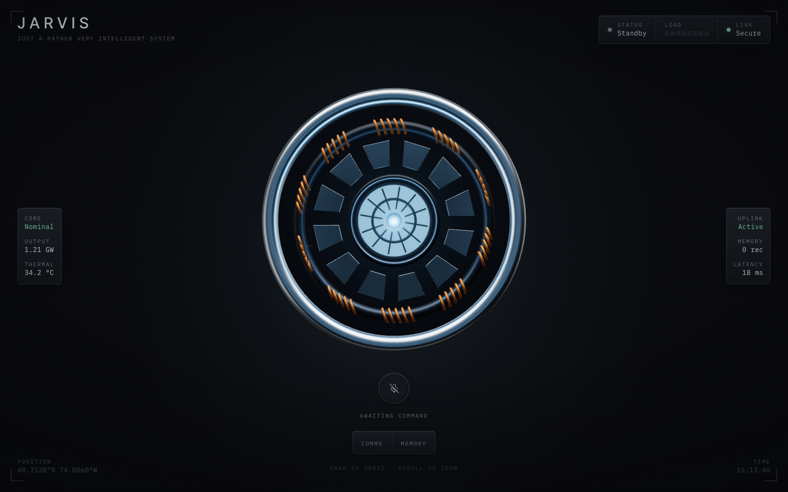
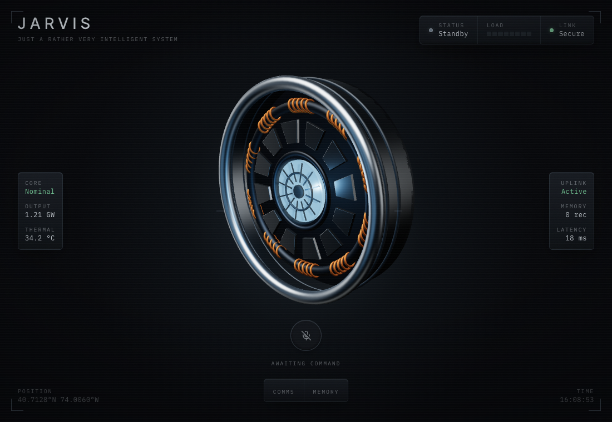
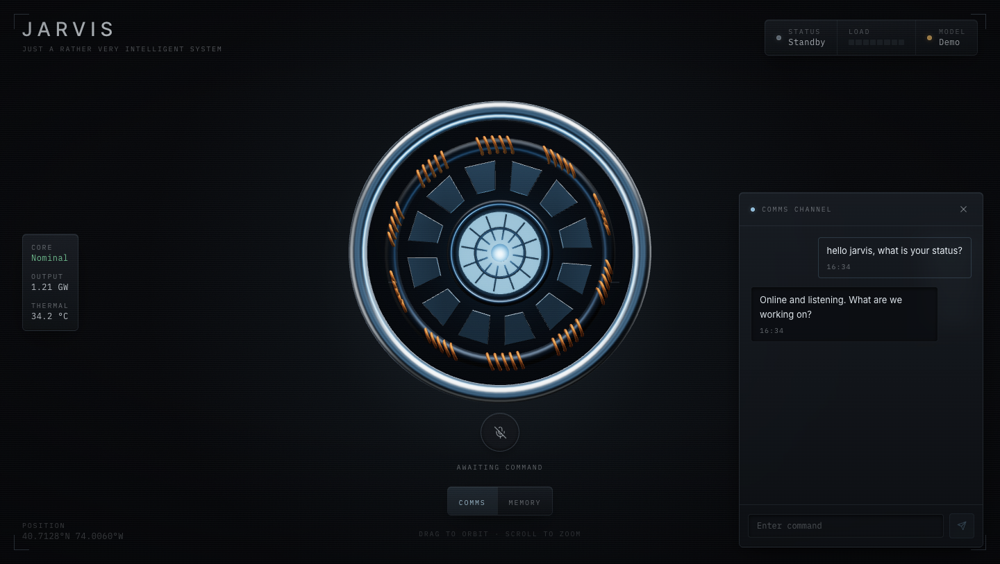

# JARVIS

A voice-driven AI assistant built around a real-time 3D arc reactor. React, Three.js, and Claude, with the model behind a rate-limited backend so the API key never reaches the browser.



## What it does

- **Orbitable 3D reactor** — a physically-lit model with copper windings, a machined housing, and a finished back. Drag to rotate, scroll to zoom; the unit stays centred.
- **Reactor reflects assistant state** — the emitter shifts colour and output between standby, listening, processing, and responding, and runs warm amber under heavy load.
- **Voice in, voice out** — browser speech recognition for input, speech synthesis for replies, with barge-in support to cut the assistant off mid-sentence.
- **Conversation memory** — recent exchanges are replayed to the model as real dialogue turns, and durable facts (name, occupation, recurring topics) are extracted and reused across sessions.
- **Always demonstrable** — with no API key configured the app serves scripted replies instead of an error, so the interface is fully explorable. The status panel reports `Demo` rather than pretending to be live.

| Orbit the reactor | Chat panel |
|---|---|
|  |  |

## Architecture

The browser never holds a provider credential. Chat requests go to this app's own `/api/chat` function, which holds the key server-side and talks to Claude:

```
browser  ──POST /api/chat──▶  edge function  ──▶  Claude (Haiku 4.5)
   │                              │
   │                         rate limiting
   │                      (per-IP + daily cap)
   ▼
scripted demo replies  ◀── 503 / 429 fallback
```

Design notes worth calling out:

- **No key in the bundle.** The env var is deliberately *not* `VITE_`-prefixed; anything with that prefix is inlined into client JS and readable by any visitor.
- **History as messages, not prose.** Prior turns are sent in the `messages` array rather than pasted into the system prompt. That keeps the system prefix byte-stable — a prerequisite for prompt caching — and gives the model structured dialogue instead of a summary of one.
- **Rate limiting is in-memory**, which resets on cold start and isn't shared across instances. That's a deliberate trade for a portfolio demo; the global daily cap is the real backstop. Production would use Vercel KV or Upstash.
- **Storage is local only.** Conversation memory lives in `localStorage` in one browser. There is no account system and no sync.

## Running it

Requires Node 18+.

```bash
git clone https://github.com/thisisreyy/jarvis.git
cd jarvis
npm install
npm run dev
```

Open http://localhost:5173. It runs in demo mode out of the box.

To connect a live model, add a key — server-side, never `VITE_`-prefixed:

```bash
cp .env.example .env
# then set ANTHROPIC_API_KEY in .env
```

Get a key from the [Anthropic Console](https://console.anthropic.com/settings/keys). The dev server runs the `/api/chat` function locally via a Vite middleware, so local development exercises the same code path as production.

### Commands

| Command | Purpose |
|---|---|
| `npm run dev` | Dev server, including the API function |
| `npm run build` | Production build |
| `npm test` | Run the test suite |
| `npm run typecheck` | Type-check app and API |
| `npm run lint` | Lint |

## Deploying

Configured for Vercel. Import the repo, then set `ANTHROPIC_API_KEY` as an environment variable in the project settings. `vercel.json` handles the SPA rewrites and leaves `/api/*` to the functions runtime.

Deploying without the key is safe — the site runs in demo mode.

## Tech

React 18 · TypeScript · Three.js via React Three Fiber · Tailwind · Framer Motion · Vite · Vitest · Anthropic SDK

## Browser support

Chrome and Edge are best supported. Speech **recognition** is unavailable in Firefox and the UI disables the mic accordingly — text chat and the 3D scene work everywhere. Voice input requires HTTPS in production.

## Known limitations

- Conversation memory is per-browser; clearing site data clears it.
- The audio-level meter driving the reactor during listening is simulated, not sampled from the mic.
- Rate limiting is per-instance in memory (see Architecture).

## License

MIT — see [LICENSE](LICENSE).
